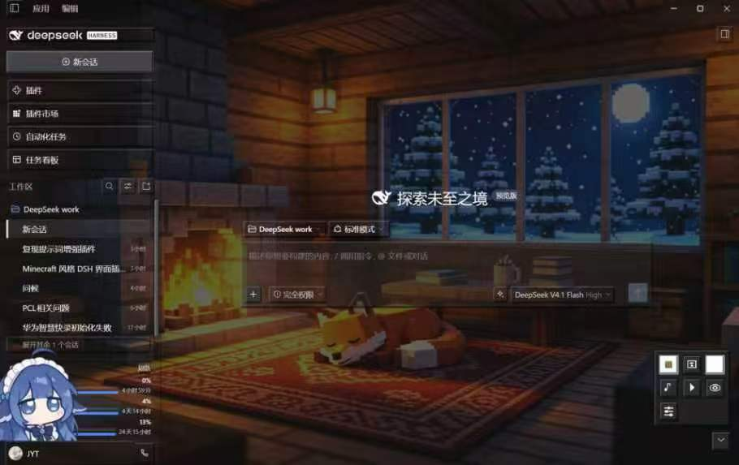
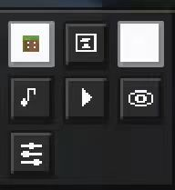
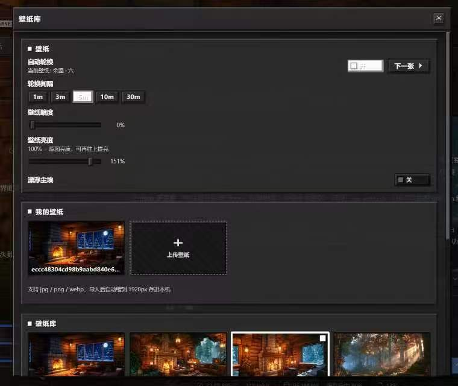

# Minecraft 主题界面 · dsh-minecraft-theme

[](https://www.npmjs.com/package/dsh-minecraft-theme)
[](LICENSE)
[](https://github.com/JYT-copy/dsh-minecraft-ui/tags)
[](https://github.com/JYT-copy/dsh-minecraft-ui#2-安装)
[](package.json)

把 DSH Web 界面整体换成 Minecraft 风格：**方块化像素组件 + 可自建的照片壁纸库 + Minecraft 界面音效 + 可自建曲库的 BGM 播放器**。
颜色不额外染色，跟随 DSH 原有的主题与亮/暗色模式。

> **⚠️ 版权说明（先读这条）**
> 这是一个非官方粉丝主题，与 Mojang Studios / Microsoft 无关。
> **自带素材**：1 张基础壁纸（`cozy-cabin.webp`）+ **5 个 Minecraft 界面音效**（约 60 KB，让点击/开箱声像原版）。
> 这 5 个音效是 Mojang 的游戏素材，**不在 MIT 许可范围内**，随包分发只出于粉丝主题的致敬目的；
> 删掉 `assets/sfx/*.mp3` 后插件会自动退回**合成音效**，功能不受影响。
> **不包含**：C418 的原声音乐、其余 Minecraft 美术素材。
> 详见 [assets/sfx/README.md](assets/sfx/README.md)、[assets/music/README.md](assets/music/README.md)、[THIRD_PARTY_NOTICES.md](THIRD_PARTY_NOTICES.md)。

- 代码 MIT；零第三方依赖、不联网：壁纸/音效/音乐全部由宿主端只读静态路由本地提供。
- 零侵入可撤销：所有样式只在 `<body data-mc-theme="on">` 下生效，关掉主题（HUD 方块开关 / `Ctrl+Alt+M`）即恢复原始 DSH 外观。
- **不改配色**：只把「表面」类令牌的透明度调低让壁纸透出来，颜色本身一律采样自当前 DSH 主题；文字、品牌色、按钮、边框保持原样。
- 跟随亮/暗色：监听 `data-ds-dark-theme`，切换时先撤掉自身覆盖、重新采样、再应用。

---

## 界面预览

整页效果：方块化面板、照片壁纸、星月窗景，右下角是 HUD 控制台。



<table>
<tr>
<td width="52%">

**HUD 控制台**（右下角，可收起）：壁纸 / 音乐 / 音效 / 背景音乐 / 设置，一个方块按钮管全部。



</td>
<td width="48%">

**壁纸库**：自动轮换、亮度/暗度/面板不透明度、我的壁纸（上传 + 删除）、内置壁纸网格。



</td>
</tr>
</table>

---

## 1. 功能

### 壁纸

| 来源 | 说明 |
| --- | --- |
| 内置 | 仓库自带 1 张：`壁炉小屋`（雪夜里的小木屋，炉火正旺）。1600px WebP + 480px 缩略图 |
| 插件目录 | 往 `assets/wallpapers/` 放 `<slug>.webp` + `<slug>.thumb.webp` 即可，格式见该目录 README |
| 界面上传 | 「我的壁纸 → 上传壁纸」，任意 `image/*`，自动纠正 EXIF 方向、缩到 1920px JPEG、另存缩略图，存进浏览器 IndexedDB |

控制项：自动轮换（关 / 1 / 3 / 5 / 10 / 30 分钟）、手动「下一张」、壁纸选择网格、暗度、
**壁纸亮度**（100% = 原图，最高 160%）、面板不透明度（**0% = 面板全透明，壁纸完全按原图显示**）、漂浮尘埃粒子。

> 想看到「壁纸本来的亮度」：`壁纸亮度` = 100%、`壁纸暗度` = 0%、`面板不透明度` = 0%，三项都不加蒙版时图片与文件逐像素一致。

### 音效

交互音效优先播放 `assets/sfx/` 里的样本；某个样本缺失时，**只有那一个音效**退回合成音（WebAudio 现场合成，无需文件）：

| 交互 | 建议样本文件 | 缺失时的合成兜底 |
| --- | --- | --- |
| 点击 / 选择 | `ui-stonecutter-select_recipe-1.mp3` | 木质短促「嗒」 |
| 打开弹窗 / 面板 / 展开控制台 | `block-chest-open-1.mp3` | 上滑音 |
| 关闭弹窗 / 面板 / 收起控制台 | `block-chest-close-1.mp3` | 下滑音 |
| 成功 / 升级提示 | `entity-firework_rocket-launch-1.mp3` | 上行三音 |
| 出错提示 | `block-wooden_door-open-1.mp3` | 低沉低通音 |
| 悬停 | —（始终合成） | 4ms 极轻 tick |

样本在插件加载时 `preload()` 解码（只建一个 suspended AudioContext，不发声），首次真实点击/按键后才 `resume()`。
开关与音量在 HUD / 选项里独立控制。

### 背景音乐

- **曲源**：插件目录 `assets/music/`（宿主端扫描并返回清单）+ **本机上传**（IndexedDB，界面里「我的音乐 → 上传音乐」，单曲上限 60 MB）。
- **播放**：采样播放，懒解码 + 最近 3 首缓存；0.35s 淡入；切歌约 1s 交叉淡入淡出；**一曲结束自动接下一首**；页面隐藏时 suspend。
- **控制**：HUD 开关、HUD「下一首」、选项面板曲目列表（点选即播并记住）、独立音量滑块。BGM 默认关闭。
- 没有曲目时列表显示引导文案，上传后立刻出现，不需要刷新。

### 组件方块化

按钮 / 卡片 / 导航栏 / 弹窗 / 输入框 / 滚动条 / 提示气泡统一为**双色斜面立体方块**（左上 2px 高光、右下 2px 暗影 + 底部投影），
按下内凹下沉 2px；输入框内凹；滚动条 12px 方形滑块；文字选中与焦点圈用主题强调色；提示气泡为 Minecraft 紫色描边；
侧栏与设置面板加极淡石纹；面板半透明 + 暗角让壁纸透出。标签页条（对话/轨迹）保持原生几何，不清洗它的边框以免挤窄。

### 其他贴近原作的细节

- **HUD 控制台**：右下角常驻。默认收纳成一个折叠按钮，展开后**向上**长出 3 列方块按钮（主题开关 / 换壁纸 / 音效 / BGM / 下一首 / 隐藏 / 选项），像素图标均为 12×12 手绘点阵。展开播开箱音、收起播关箱音，弹出的面板关闭同样有关箱音。
- **隐藏控制台**：展开条最右侧的眼睛按钮一键隐藏；恢复：`设置 → Minecraft 主题 → 界面 → 显示控制台`，或 `MinecraftUI.showHud(true)`。
- **成就弹窗**：切主题、切壁纸、开音效、切曲目、上传素材时右上角弹「成就达成」提示（可关）。
- **快捷键**：`Ctrl/⌘ + Alt + M` 一键开关整套主题。
- **设置页**：`设置 → Minecraft 主题`，与 HUD 同一份配置。

---

## 2. 安装

要求：DSH ≥ 0.2.1-rc.1，Node 22.19+ / 24+。

**方式 A：从 npm 装（推荐）**

```text
plugin_manager install_bundle  dsh-minecraft-theme
```

> npm 包名是 `dsh-minecraft-theme`，不是仓库名 `dsh-minecraft-ui`——因为 `dsh-minecraft-ui`
> 这个名字早在 2026-08 就被另一位作者的同类插件占用（见 [npm](https://www.npmjs.com/package/dsh-minecraft-ui)），
> 所以这里换了名但保持同一个项目。仓库地址仍是 `JYT-copy/dsh-minecraft-ui`。

**方式 B：从源码/本地目录装**（想改代码、或没网时）

把仓库克隆（或下载解压）到任意目录，然后安装这个「bundle 包」：

```text
# DSH 的插件安装工具（Web GUI 的插件面板 / agent 的 plugin_manager 工具同理）
plugin_manager install_bundle  <仓库在本机的绝对路径>
```

`install_bundle` 会把包加进 profile 依赖并写入 `dsh.profile.bundles`。
**不要**手动改 profile 的 `package.json` / `cordis.patch.yml`，也不要在 profile 目录里跑 pnpm —— 那是 DSH 自己管理的部分。

装好 → **Ctrl+R 刷新页面** → 右下角出现方块控制台。
听不到声音时：先随便点一下界面（浏览器要求先有用户手势才允许播放音频），再开「设置 → Minecraft 主题 → 音效」。

卸载：

```text
plugin_manager remove_bundle  dsh-minecraft-theme
```

> 早期版本安装名是 `dsh-minecraft-ui`（目录名可能还留在 profile 里）。
> 从旧版升级：先 `plugin_manager remove_bundle dsh-minecraft-ui`，再按上面的方式装新版。

### 宿主端只读路由

```text
GET /api/minecraft-ui/wallpapers                     # 壁纸清单 JSON { ok, photos: [{ slug, name, desc }] }
GET /api/minecraft-ui/wallpapers/<slug>.webp         # 1600px 大图
GET /api/minecraft-ui/wallpapers/<slug>.thumb.webp   # 480px 缩略图
GET /api/minecraft-ui/sounds/<name>.mp3              # 音效样本（缺失返回 404，客户端自动兜底）
GET /api/minecraft-ui/music                          # BGM 清单 JSON { ok, tracks: [{ file, name, size }] }
GET /api/minecraft-ui/music/<file>                   # BGM 文件（ogg/oga/mp3/m4a/wav/flac）
```

壁纸名只允许 `^[a-z0-9][a-z0-9-]*(\.thumb)?\.webp$`，音效只允许 `^[a-z0-9][a-z0-9._-]*\.mp3$`，
音乐只接受已知音频扩展名且拒绝任意路径分隔符与 `..`；音乐清单 `no-store`，随放随发现。

---

## 3. 素材自备 / 替换

| 想补什么 | 怎么做 | 要刷新吗 |
| --- | --- | --- |
| 壁纸 | 界面里上传；或放进 `assets/wallpapers/` 并写 `manifest.json`（格式见该目录 README） | 放文件夹需要 Ctrl+R |
| BGM | 界面里「我的音乐 → 上传音乐」；或放进 `assets/music/` | 放文件夹需要 Ctrl+R |
| 音效 | **已自带 5 个**；想换音色就覆盖 `assets/sfx/` 里的同名 mp3，想关掉就删文件（自动退回合成音） | 需要 Ctrl+R |

三处都不需要重新 build、也不需要重装插件：宿主端按目录实时读取。
音乐与额外壁纸**刻意不随仓库发布**（版权原因，见 [docs/OPEN-SOURCE.md](docs/OPEN-SOURCE.md)）；
5 个短音效按你的决定随包发布，但仍在 [THIRD_PARTY_NOTICES.md](THIRD_PARTY_NOTICES.md) 里说明了权利归属。

---

## 4. 配置默认值

```js
{
  enabled: true,
  wallpaper: { auto: true, intervalSec: 300, sceneId: 'photo-cozy-cabin', dim: 0, gain: 1.18, blur: 0 },
  sfx:       { enabled: true, volume: 0.55 },
  bgm:       { enabled: false, volume: 0.22, trackId: '' },
  ui:        { glass: 0.5, achievements: true, hudHidden: false, hudDrop: 28 }
}
```

存在 `localStorage`（键 `dsh-minecraft-ui:options`，带 `__v` 版本号）；数值在读取与写入时都会被夹到合法区间，
手改 localStorage 也不会把界面弄坏。

### 控制台 API

页面里始终挂着 `window.MinecraftUI`（主题关闭时也在，便于排查）：

```js
MinecraftUI.options()                      // 当前全部配置
MinecraftUI.set({ wallpaper: { gain: 1.3, dim: 0 } })
MinecraftUI.reset()
MinecraftUI.listWallpapers()               // [{ id, name, kind }]（我的 + 目录）
MinecraftUI.listUserWallpapers()           // 只有上传的
MinecraftUI.setWallpaper('photo-cozy-cabin')
MinecraftUI.nextWallpaper()
MinecraftUI.deleteWallpaper('user-xxxx')
MinecraftUI.refreshUserWallpapers()
MinecraftUI.listBgmTracks()                // [{ id, name, source: 'file' | 'user' }]
MinecraftUI.listUserMusic()                // 只有上传的音乐
MinecraftUI.setBgmTrack('<id>')
MinecraftUI.nextBgmTrack()
MinecraftUI.refreshUserMusic()
MinecraftUI.deleteUserMusic('user-music-xxxx')
MinecraftUI.toggleTheme()
MinecraftUI.showHud(false)                 // 隐藏控制台；true 恢复
MinecraftUI.setHudDrop(28)                 // 控制台底距（px）
MinecraftUI.audio                          // 直接拿音频引擎
```

---

## 5. 开发

```text
build.mjs            把 src/ 下 10 个片段按顺序拼成 lib/client.js（含语法与结构校验）
src/00-head.js       __ModuleLoader__ 外壳 + 常量
src/10-store.js      配置存储（localStorage v7）、中英文字典、采样式半透明令牌
src/25-photos.js     壁纸目录：从宿主路由拉清单的动态目录（manifest 合并、订阅）
src/27-library.js    本机库：壁纸 + 音乐（IndexedDB v2、缩放、缩略图、增删、上限校验）
src/30-audio.js      音频引擎：SFX 采样（含合成兜底）+ BGM 采样播放（清单/懒解码/交叉淡入/用户曲目）
src/40-styles.js     全部 CSS（~25KB，146 条规则）
src/45-runtime.js    壁纸层与轮换、粒子、音效事件委托、主题同步、库订阅、BGM 同步、HUD 对齐
src/50-ui.js         React 组件（HUD / 壁纸库含上传删除 / 音乐库含上传删除 / 选项 / 设置页 / 成就栈）
src/60-apply.js      生命周期：注册 locale → 注入 CSS → 应用配色 → 启动运行时 → preload → 注册插槽
src/99-tail.js       导出 { name, inject, apply }
index.js             宿主端：壁纸 / 音效 / 音乐路由（inject: webServer）
assets/wallpapers/   基础壁纸 + 清单 + 说明（其余壁纸不入仓库）
assets/music/        空目录 + 说明（C418 音乐不入仓库）
assets/sfx/          5 个 Minecraft 界面音效 + 说明（随包发布，版权见 THIRD_PARTY_NOTICES.md）
test/                自检脚本（不随插件包发布）
docs/OPEN-SOURCE.md  开源发布指南与版权处理
```

改动流程：改 `src/**` → `node build.mjs` → 刷新页面。`lib/client.js` 由 profile 的符号链接直接供给，不必重装；
改 `index.js` 或 `assets/` 后需要 `remove_bundle` + `install_bundle` 让宿主端重新加载并注册路由。

> `MC_CSS` 是一整段模板字符串，**里面不能出现反引号**，否则构建会报
> `Invalid left-hand side expression in postfix operation`。

### 自检脚本

```text
node build.mjs                     # 构建 + 语法/结构校验
node test/css-parse.cjs            # lightningcss 真解析（规则数与警告）
node test/runtime-smoke.cjs        # 配置合并/夹取/损坏与旧版本迁移 + 令牌表
node test/audio-selftest.cjs       # 音频：preload/样本映射/BGM 清单与切歌/用户曲目/节点配平/零泄漏
node test/user-library-test.cjs    # 本机库：IndexedDB 壁纸 + 音乐增删、缩放、缩略图、v1→v2 迁移
node test/symbol-audit.cjs         # 拼接后 bundle 的标识符声明审计
node test/parse-locate.cjs         # 构建失败时定位出错片段的本地行号
```

---

## 6. 设计取舍

- **配色不自己发明**：早期版本自定义过一套苔绿石板色，反馈是「界面不要发绿」。现在 `mcTokens()` 只改**表面类**令牌（bg-base / layer-1..3 / overlay / sidebar-fill / bubble / input / menu / tip）的 alpha，RGB 采样自 `getComputedStyle(document.body)` 上 DSH 自己的令牌值；换肤时先 `mcStripPalette()` 再重新采样，避免读到自己写的值。
- **壁纸可见性**：壁纸是 `z-index:-2` 的固定层，必须同时满足三件事——`#root`/窗口 frame 不涂不透明底色、面板表面令牌半透明（默认 `ui.glass = 0.5`，可到 0）、`<html>` 上也挂一份 `background-image` 兜底。旧版默认 `glass = 0.9`（面板 79% 不透明）是「看不见壁纸」的主因。
- **素材走宿主路由而非内联**：壁纸、音效、音乐内联会把 bundle 撑到几十 MB；全部由宿主端 `webServer.register` 提供静态文件，客户端只拼 URL。清单路由还让「往目录扔文件」即刻生效。
- **BGM 用采样而非合成**：合成循环与 Minecraft 听感差距明显；现在播放你自己的曲目，懒解码 + LRU 3 首控制内存，切歌用双 source 交叉淡入避免爆音。
- **用户库放 IndexedDB**：上传的 `File` 只存在于浏览器进程，宿主半拿不到（没有跨进程文件通道），base64 RPC 又会被几 MB 的原图撑爆；IndexedDB 能存 Blob、不受 localStorage 5MB 配额限制。壁纸与音乐共用一个数据库、一次 `open`。
- **素材边界按体积/风险分级**：C418 音乐与第三方壁纸是完整作品，全部由 `.gitignore` 排除、再由 `package.json` 的 `files` 白名单二次兜底；5 个 ~60 KB 的短音效（开箱/石切机/烟花/木门）决定随包发布，因为它们决定「像不像 Minecraft」，并在 `THIRD_PARTY_NOTICES.md` 与 `assets/sfx/README.md` 里明确标注 Mojang 归属、不在 MIT 之内；缺样本时靠合成兜底保证可用。
- **音效只挂在交互元素上**：事件委托 + 捕获阶段，遍历 `button/a/[role=button]/[role=tab]/[role=menuitem]/…`，跳过插件自身 UI（`[data-mc-ui]`），避免误响。
- **HUD 位置**：对齐发送键试过三种办法，前两种在真实页面里落到错误元素、把 HUD 顶到屏幕中间。最终是「固定右下角 + 带可信区间的微调」：只有量到的高度落在 30–150px 才采用。宁可少对齐一格，也不能再错位。
- **默认值克制**：壁纸 `壁炉小屋`、音效默认开但音量 0.55、BGM 默认关——不会一装上就突然响。

---

## 7. 已知限制

- **渲染效果未由机器验证**：从命令行安装并校验（CSS 可解析、模块可加载、插槽已注册、资源路由 200/404、构建产物语法通过、自检脚本全绿），但像素级视觉与听感需要人眼人耳确认。
- 5 个音效样本随包发布（Mojang 素材，不在 MIT 许可内）；若它们被移除，插件会自动使用**合成音效**，功能不受影响。
- 音乐与额外壁纸不随仓库发布（版权原因），需要使用者自备或界面上传。
- 依赖 DSH 的主题令牌与 `data-ds-dark-theme`、`data-dsh-surface` 等语义属性；DSH 大版本改版后若令牌更名，需同步调整 `src/10-store.js` 的 `MC_STOCK_PROBE` 列表（缺失时自动退回内置兜底色）。
- HUD 的微调是启发式的：输入框布局若大改，最多回到固定右下角，不会错位到屏幕中间。
- `shell.overlay` 是点击穿透层，HUD 与弹窗已显式 `pointer-events: auto`。
- 未发生任何点击/按键前不会创建 AudioContext，这是浏览器策略而非缺陷。
- 上传的壁纸与音乐存在浏览器 IndexedDB：换浏览器、清站点数据、无痕窗口关闭后会丢失；插件目录里的文件不受影响。
- BGM 曲目按文件名排序；目录清单在页面加载时拉取，新放进目录的文件刷新后才出现（界面上传的立刻出现）。
- 浏览器对 ogg/opus、部分 flac 的 `decodeAudioData` 支持有限（Safari 尤其），解码失败会跳过该曲并 warn。

---

## 8. 许可

代码以 [MIT](LICENSE) 发布。第三方声明（Minecraft 素材不在许可范围内）见 [THIRD_PARTY_NOTICES.md](THIRD_PARTY_NOTICES.md) 与 [docs/OPEN-SOURCE.md](docs/OPEN-SOURCE.md)。
